# A&R Chat

Plataforma web para empresas **gerenciarem o atendimento aos clientes pelo WhatsApp** e **dispararem campanhas de
marketing**. As conversas ficam numa tela única, separadas pelo status do atendimento (aguardando, em andamento,
em espera e finalizado); cada mensagem enviada é cobrada (pré-pago ou pós-pago) e passa por uma fila com prioridade.

## Estrutura do projeto

```
ar-chat/
├── backend/                      API REST — Java 21 + Spring Boot 4, arquitetura limpa
├── docs/
│   ├── 01-documento/             Entrega do Documento Final até Especificações de Requisitos.docx
│   ├── 02-apresentacao/          Apresentação do Estágio I (.pptx, modelo UMFG)
│   ├── 03-diagramas/             Casos de uso, classes, estados, atividades, sequência, DER, arquitetura (PNG)
│   ├── 04-prototipos/            Protótipos das telas: atendimento, canal, campanha (PNG)
│   ├── 05-postman/               Collection e ambiente do Postman (login automático)
│   └── fontes/                   Fontes PlantUML dos diagramas, gerador do documento e script dos diagramas
├── docker-compose.yml
└── .env.example                  Variáveis (copie para .env — o .env não vai para o Git)
```

## Escopo: 3 cadastros, 3 movimentações, 3 relatórios

| Tipo | Funcionalidades |
|---|---|
| Cadastros | Clientes · Destinatários (contatos e grupos do WhatsApp) · Administradores |
| Movimentações | **Realizar Atendimento** (responder, colocar em espera, retomar, finalizar) · **Disparar Campanha de Marketing** · Movimentar Créditos e Limites |
| Relatórios | **Atendimentos Finalizados** · Faturamento por Cliente · Desempenho das Campanhas (todos exportam CSV) |
| Apoio | Login · Fila de envio com prioridade (worker) · Receber mensagens (webhook) · Canal: **WhatsApp Web** (Z-API) e WhatsApp Business (**em breve**) |

Nenhuma movimentação depende da Z-API: ela é só o canal que entrega as mensagens e avisa respostas, entregas e leituras.

## Como executar

Pré-requisitos: Java 21 e Docker (Colima neste Mac: `colima start`).

```bash
# 1. Banco PostgreSQL na porta 5433 (as tabelas são criadas pelo Flyway na primeira execução)
docker run -d --name archat-postgres --restart unless-stopped -e POSTGRES_DB=archat -e POSTGRES_USER=archat \
  -e POSTGRES_PASSWORD=archat -p 5433:5432 -v archat-dados-postgres:/var/lib/postgresql/data postgres:16-alpine

# 2. API
cd backend
./mvnw spring-boot:run
```

- API e Swagger: http://localhost:8080 (abre o Swagger) — admin inicial `admin` / `admin12345`
- Banco no DBeaver: `localhost:5433`, base `archat`, usuário `archat`, senha `archat`
- Postman: importe os dois arquivos de `docs/05-postman` e rode a collection (login automático)

### Envio real pelo WhatsApp (Z-API)

No `.env` da raiz: `ARCHAT_ENVIO_PROVEDOR=zapi`, `ARCHAT_ZAPI_URL`, `ARCHAT_ZAPI_INSTANCIA`, `ARCHAT_ZAPI_TOKEN`,
`ARCHAT_ZAPI_CLIENT_TOKEN`. Sem isso, o envio é **simulado** (padrão, ideal para testes e demonstração).

Webhooks (a Z-API exige HTTPS — em desenvolvimento, use um túnel como o `cloudflared`):
- Ao receber: `https://SEU-ENDERECO/webhooks/zapi/<ARCHAT_WEBHOOK_SEGREDO>/received`
- Status da mensagem: `https://SEU-ENDERECO/webhooks/zapi/<ARCHAT_WEBHOOK_SEGREDO>/status`

Sem webhook, dá para demonstrar o atendimento com `POST /conversations/{id}/simulate-reply`.

### Testes

```bash
cd backend && ./mvnw verify   # unitários, arquitetura (ArchUnit) e integração (H2) — nunca usam a Z-API real
```

### Diagramas e documento

```bash
docs/fontes/gerar-diagramas.sh /caminho/plantuml.jar   # regenera 03-diagramas e 04-prototipos
```

## Diagramas

### Casos de uso
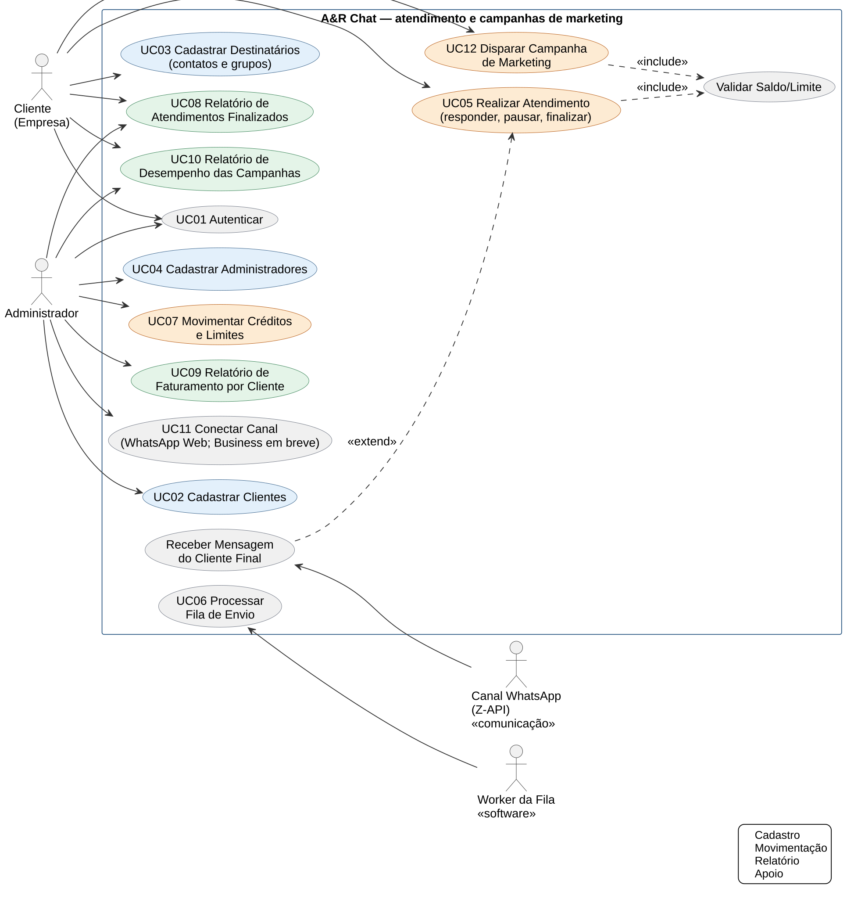

### Estados do atendimento
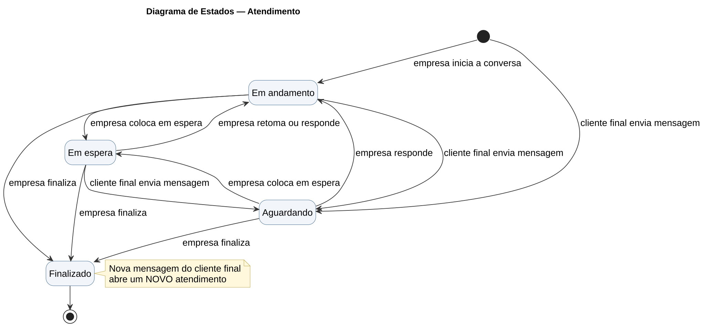

### Atividades – enviar resposta do atendimento
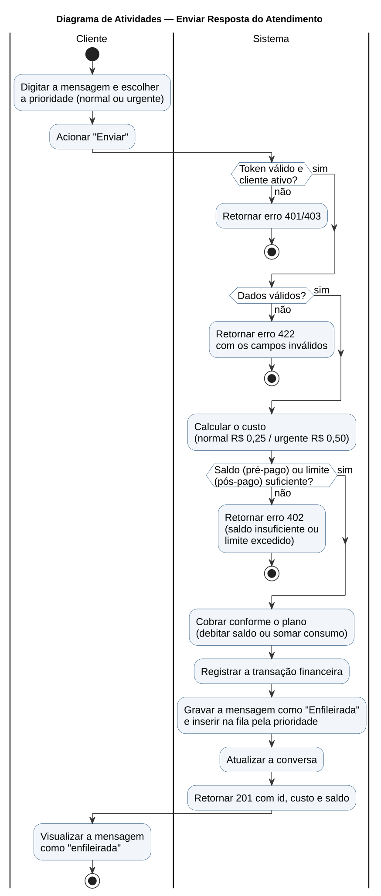

### Sequência – enviar uma resposta
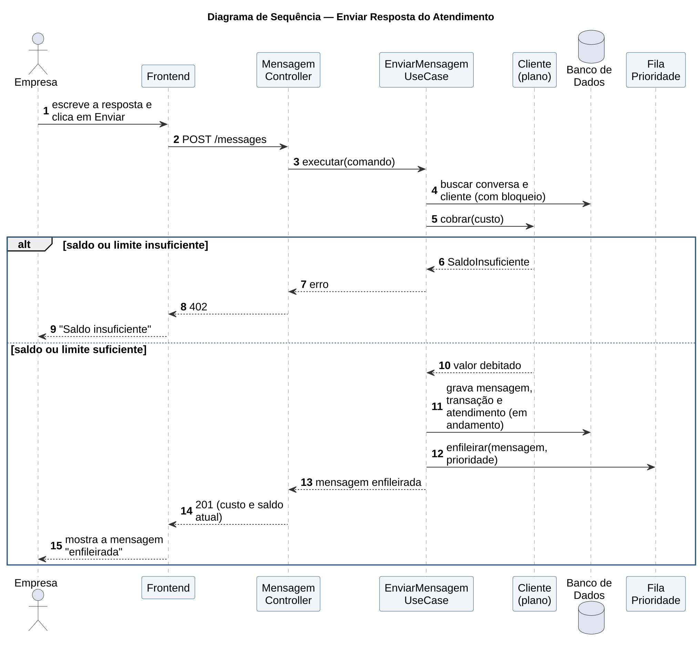

### Sequência – processar a fila e confirmar a entrega
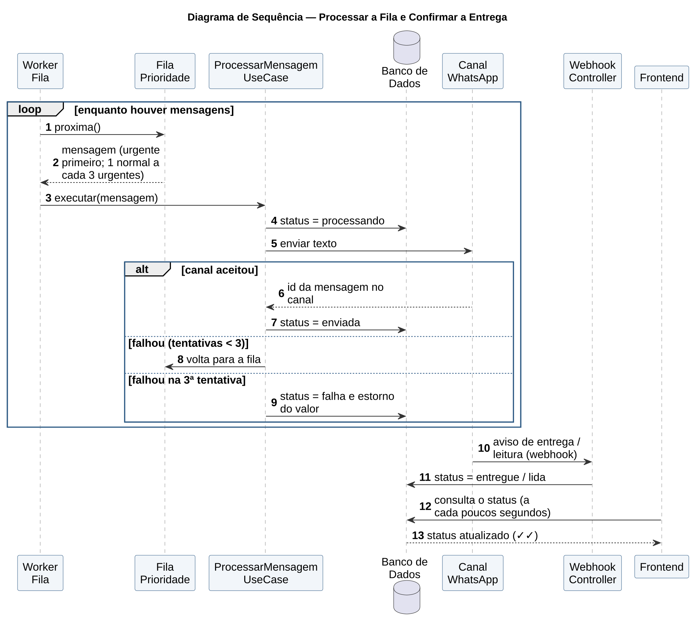

### Estados da mensagem
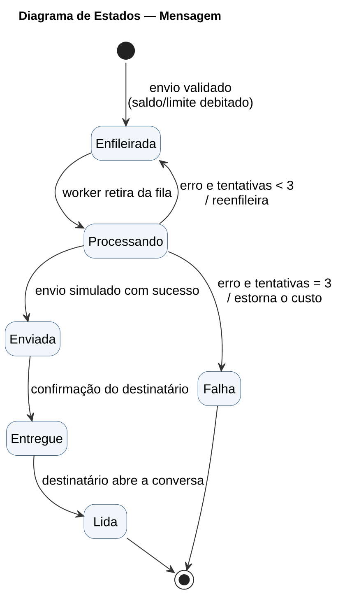

### Classes – entidades do domínio
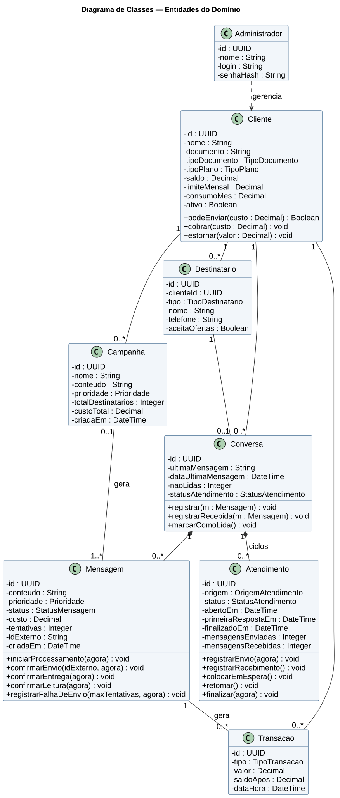

### Classes – cobrança, fila de envio e enumerações
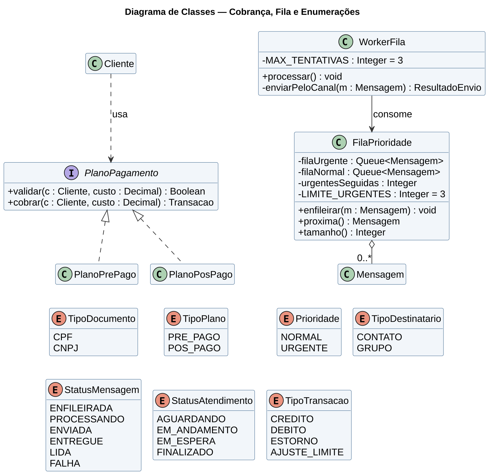

### Arquitetura
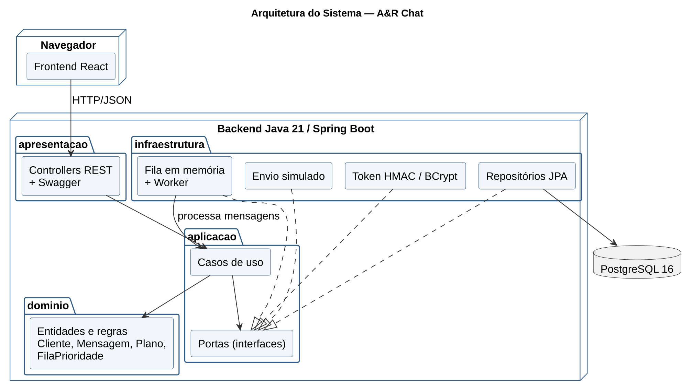

### Modelo de entidade e relacionamento
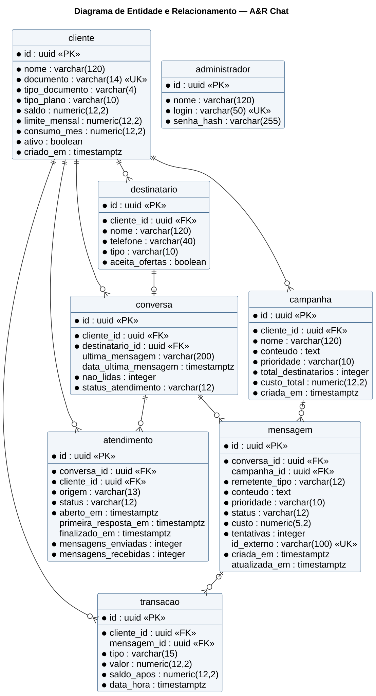

### Protótipos
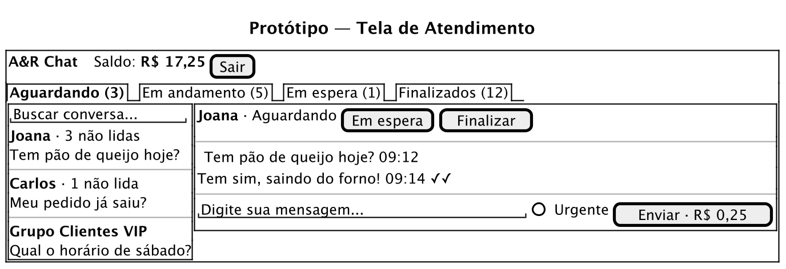
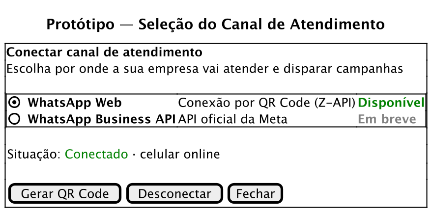
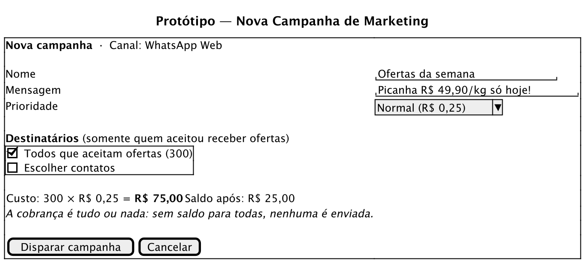

## Arquitetura

```
apresentacao   → controllers REST, DTOs (JSON em inglês), token Bearer, webhooks, erros, CSV
infraestrutura → JPA/PostgreSQL, fila em memória + worker, envio (simulado ou Z-API), HMAC, BCrypt
aplicacao      → casos de uso e portas (interfaces) — Java puro
dominio        → regras: Cliente e planos (Strategy), Mensagem e Atendimento (máquinas de estado), FilaPrioridade
```

As dependências apontam sempre para dentro; o teste `ArquiteturaLimpaTest` falha se essa regra for quebrada.

### Decisões técnicas

- **Atendimento**: cada conversa tem ciclos de atendimento com status próprio; mensagem do cliente final abre ou
  volta para "aguardando", resposta da empresa põe "em andamento". Campanha de marketing não abre atendimento.
- **Fila com prioridade e anti-starvation**: urgentes primeiro, uma normal a cada 3 urgentes; O(1).
- **Consistência financeira**: cobrança, transação e mensagem na mesma transação, com bloqueio do cliente
  (`SELECT … FOR UPDATE`); 3 tentativas (contando a primeira) e estorno na falha definitiva.
- **Campanhas**: tudo ou nada, até 1.000 contatos, só com consentimento (LGPD); pausa configurável entre envios.
- **Canal como porta** (`EnvioMensagemGateway`): simulado ou Z-API; o WhatsApp Business entra como novo adaptador.

### Limitações / próximos passos

- Senha para o login do cliente e JWT padrão (RFC 7519) — hoje o cliente entra só com CPF/CNPJ.
- Chave de idempotência no envio (evitar cobrança duplicada em reenvio da mesma requisição).
- Canal WhatsApp Business (API oficial) — "em breve".
- Frontend React (próxima etapa).
